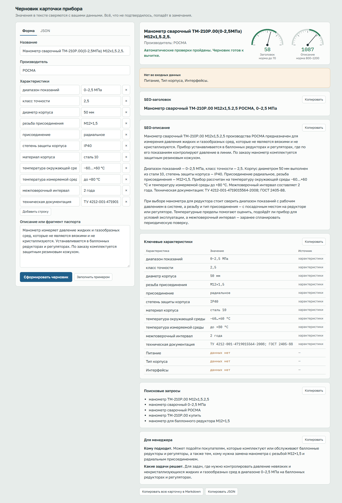

# AI-помощник для товарных описаний

Локальный сервис для контент-менеджера B2B-магазина контрольно-измерительных приборов. На вход получает данные о приборе, на выходе отдаёт черновик карточки: SEO-заголовок, SEO-описание, характеристики, поисковые запросы и справку для менеджера.

Главная идея: текст пишет модель, а факты контролирует код. Значения из `specs` в таблицу характеристик копирует программа, а всё, что написала модель, сверяется со входными данными. Что не подтвердилось, попадает в замечания к черновику.



На снимке сохранённый результат модели для [манометра ТМ-210Р.00](examples/output/manometer_tm210.md), выведенный на странице сервиса.

## Соответствие заданию

| Требование | Где выполнено |
| --- | --- |
| Данные в JSON или через веб-форму | `POST /api/generate` и страница на `/` с формой и вкладкой JSON |
| Передача данных в LLM через API | Anthropic API, структурированный вывод по схеме: [app/llm.py](app/llm.py) |
| Результат в удобном для копирования виде | Ответ API содержит JSON и Markdown, на странице копируется каждый блок и вся карточка |
| Сообщать, каких полей нет или что уточнить | `missing_fields`, `needs_clarification` и строки «данных нет» в характеристиках |
| SEO-заголовок до 70 символов, описание 800–1200, 3–5 запросов | Задано в промпте, проверяется кодом в [app/guards.py](app/guards.py), при нарушении повтор в [app/pipeline.py](app/pipeline.py) |
| Структурированный список характеристик | `characteristics`: название, значение и источник (`specs`, `description` или «данных нет») |
| Commercial-блок для менеджера | `commercial.audience` (кому подходит) и `commercial.tasks` (какие задачи решает) |
| API-ключ не в коде | Переменная `ANTHROPIC_API_KEY` из `.env`, файл в `.gitignore` |
| Ошибки API, пустые поля, некорректный JSON | Понятные сообщения и коды, см. [Ошибки](#ошибки) |
| Не выдумывать характеристики, отмечать отсутствующие | Запрет в промпте, сверка чисел, единиц и терминов кодом, характеристики из `specs` копирует программа |
| README, примеры на двух товарах, промпты и решения, ограничения | Разделы [Запуск](#запуск), [Примеры](#примеры-на-двух-товарах), [Промпты](#промпты), [Принятые решения](#принятые-решения), [Ограничения](#ограничения), [Что можно улучшить](#что-можно-улучшить) |

## Запуск

Нужен Python 3.11 или новее (проверено на 3.13) и ключ [Anthropic API](https://console.anthropic.com/).

**Windows (PowerShell):**

```powershell
python -m venv .venv
.venv\Scripts\python.exe -m pip install -r requirements.txt
Set-Content .env "ANTHROPIC_API_KEY=your_key" -Encoding ascii
notepad .env
.venv\Scripts\python.exe -m uvicorn app.main:app --port 8000
```

**Linux и macOS:**

```bash
python3 -m venv .venv
.venv/bin/python -m pip install -r requirements.txt
echo "ANTHROPIC_API_KEY=your_key" > .env
nano .env
.venv/bin/python -m uvicorn app.main:app --port 8000
```

В файле `.env` замените `your_key` на свой ключ. Файл перечислен в `.gitignore`. Необязательные настройки там же: `ANTHROPIC_MODEL` (модель, по умолчанию `claude-opus-5-5`), `LLM_BASE_URL` (адрес API) и `ALLOWED_HOSTS` (адреса сервиса через запятую, по умолчанию `localhost,127.0.0.1`). После запуска откройте <http://localhost:8000>.

Без ключа сервис тоже запустится: страница работает, проверка входных данных работает, а на запрос генерации придёт понятная ошибка `503`.

## Использование

**Веб-страница.** Заполните форму или вставьте JSON на одноимённой вкладке и нажмите «Сформировать черновик». Каждый блок копируется отдельно, вся карточка копируется в Markdown или JSON. Шкалы вверху показывают длину заголовка и описания относительно нормы.

Команды ниже выполняются в окружении `.venv`: сначала активируйте его или замените `python` на путь из раздела «Запуск».

**API**, Linux и macOS:

```bash
curl -X POST http://localhost:8000/api/generate \
  -H "Content-Type: application/json" \
  -d @examples/edge_cases/assignment_example.json
```

Windows (PowerShell):

```powershell
curl.exe -X POST http://localhost:8000/api/generate -H "Content-Type: application/json" --data-binary "@examples/edge_cases/assignment_example.json"
```

Ответ содержит `card` (структура ниже) и `markdown` (та же карточка текстом).

**Пакетная генерация** из папки с JSON-файлами:

```bash
python -m scripts.generate_examples --input-dir examples/input --output-dir examples/output
```

### Входные данные

```json
{
  "name": "Манометр показывающий DM 02",
  "manufacturer": "Манотомь",
  "specs": {"диапазон измерений": "0–1,6 МПа", "класс точности": "1,5"},
  "description": "Прибор предназначен для измерения избыточного давления..."
}
```

Обязательны `name` и хотя бы одно из полей `specs` или `description`. Пустые значения и заглушки (`""`, `null`, `-`, `н/д`, `нет данных`) считаются отсутствующими. Значение `нет` считается фактом о приборе. Название, производитель, описание и названия характеристик без единой буквы считаются мусором и до модели не доходят, значения характеристик могут быть числами.

### Результат

```json
{
  "status": "ok | needs_attention",
  "name": "...",
  "manufacturer": "...",
  "seo_title": "до 70 символов",
  "seo_description": "800–1200 символов",
  "characteristics": [{"name": "...", "value": "... или «данных нет»", "source": "specs | description | none"}],
  "search_queries": ["3–5 запросов"],
  "commercial": {"audience": "кому подходит", "tasks": "какие задачи решает"},
  "missing_fields": ["чего нет во входных данных"],
  "needs_clarification": [{"field": "...", "reason": "что уточнить"}],
  "warnings": ["какие проверки не пройдены"],
  "meta": {"title_length": 0, "description_length": 0, "attempts": 1, "model": "..."}
}
```

`status` равен `needs_attention`, если есть предупреждения или вопросы к данным. Отсутствие полей само по себе статус не меняет: у механического манометра может просто не быть питания.

### Ошибки

| Ситуация | Код | `error.code` |
| --- | --- | --- |
| Битый JSON | 400 | `invalid_json` |
| Не объект, неверные типы полей | 422 | `invalid_structure` |
| Нет названия или в нём нет букв, либо нет ни характеристик, ни описания | 422 | `insufficient_data` |
| Тело запроса больше 100 КБ | 413 | `body_too_large` |
| Тип данных не `application/json` | 415 | `unsupported_media_type` |
| Запрос с адреса не из `ALLOWED_HOSTS` | 403 | `forbidden_host` |
| Не задан ключ | 503 | `missing_api_key` |
| Неверный ключ, нет доступа | 502 | `llm_auth` |
| Модель не найдена | 502 | `llm_model_not_found` |
| Превышен лимит запросов | 429 | `llm_rate_limit` |
| LLM отклонила запрос, например закончился баланс | 502 | `llm_bad_request` |
| Сервис LLM недоступен, таймаут | 502 | `llm_unavailable` |
| Отказ модели, неполный ответ | 502 | `llm_refusal`, `llm_bad_response` |

В первых семи случаях запрос к LLM не отправляется. Проверки адреса и типа данных не дают чужому сайту тратить ключ через сервис на `localhost`.

## Как это работает

```text
JSON или форма
  → проверка и оценка полноты       app/input_checks.py
  → вызов модели                    app/llm.py, app/prompts.py
  → проверка ответа                 app/guards.py
  → при нарушениях: повтор с описанием ошибок, всего до 3 попыток    app/pipeline.py
  → карточка в JSON и Markdown      app/render.py
```

## Промпты

Текст находится в [app/prompts.py](app/prompts.py). Запрос состоит из трёх частей.

**Системное сообщение** задаёт правила и не содержит данных товара:

- технические значения берутся только из входных данных, в том же написании, без пересчёта единиц;
- перечислено, что нельзя упоминать без подтверждения: ГОСТ, степень защиты, материалы, сертификаты, поверка, гарантия и другое;
- описан каждый блок результата. Для описания задана цель 900–1100 символов: запас от границ 800–1200 снижает число повторов;
- при нехватке фактов объём предлагается набирать пояснениями о назначении прибора, а не новыми сведениями;
- `commercial` прямо описан как вывод из назначения прибора, поэтому формулировки должны быть осторожными;
- в `extracted_specs` попадают только технические параметры с конкретным значением, а `value` должен быть дословной частью цитаты. Назначение и измеряемая среда остаются в тексте: иначе модель меняет падеж, и проверка цитаты отбрасывает верные данные.

**Сообщение пользователя** содержит данные в теге `<product_data>`, список полей, которых нет в `specs`, и вопросы, уже найденные кодом, чтобы модель их не повторяла. Поля из списка не запрещены: если сведения есть в `description`, модель должна их извлечь. Содержимое тега объявлено данными, а не указаниями. Символ `<` в JSON заменяется на `\u003c`, поэтому текст описания не может закрыть тег.

**Сообщение для повтора** добавляет предыдущий черновик и список конкретных нарушений: например, «значения 16 бар нет во входных данных». Каждая попытка — новый запрос без истории.

Всё, что происходит из входных данных или ответа модели, передаётся как JSON внутри тегов, включая названия характеристик в списке отсутствующих полей. Вне тегов остаётся только постоянный текст инструкций.

Формат ответа задан схемой Pydantic через структурированный вывод Anthropic API, поэтому разбирать текст не нужно.

## Принятые решения

**Факты проверяет код, а не промпт.** Только инструкция не гарантирует результат, поэтому в [app/guards.py](app/guards.py) есть детерминированные проверки:

| Проверка | Что ловит |
| --- | --- |
| Длины и количество | Заголовок больше 70 символов, описание вне 800–1200, не 3–5 запросов |
| Пара «число + единица» | «1,5 МПа», когда 1,5 — это класс точности; «16 бар» как пересчёт из 1,6 МПа |
| Голое число | Любое число, которого нет во входных данных |
| Стоп-термины | ГОСТ, IP, RS-485, материалы, гарантия и другие утверждения без подтверждения во входе |
| Обозначение модели | «ДМ 02» вместо «DM 02» |
| Фраза «данных нет» | Служебная пометка в публичном тексте |

**Характеристики из описания требуют цитаты.** Модель возвращает значение вместе с дословным фрагментом `description`. Если фрагмента в тексте нет или значения нет во фрагменте, характеристика отбрасывается с предупреждением. Значение из `specs` важнее значения из описания.

**Заголовок не обрезается автоматически.** Обрезка дала бы оборванную фразу. Если модель не уложилась за 3 попытки, менеджер видит текст как есть и предупреждение.

**«Данных нет» вместо «не применимо».** Решить, что у прибора нет питания, — тоже домысел, поэтому такой вывод остаётся за менеджером.

**Адрес API задан явно.** SDK по умолчанию читает `ANTHROPIC_BASE_URL` из окружения и мог бы отправить ключ на чужой адрес. Сменить адрес можно отдельной настройкой `LLM_BASE_URL`.

**Claude Opus 5.5 и один провайдер.** В задании нужна одна LLM, поэтому абстракции над провайдерами нет. Модель меняется переменной `ANTHROPIC_MODEL`. Серверные резервные модели (`fallbacks`) не подключены: это beta, а отказ на описании прибора маловероятен. Отказ обрабатывается как обычная ошибка.

## Примеры на двух товарах

Товары выбраны из [выгрузки каталога](https://www.souz-pribor.ru/yml/any/feed.xml), которую предоставил работодатель. Они разные по устройству: механический манометр и электронный модуль с питанием и интерфейсом.

| Товар | Вход | Результат | Страница товара |
| --- | --- | --- | --- |
| Манометр сварочный ТМ-210Р.00, РОСМА | [JSON](examples/input/manometer_tm210.json) | [Markdown](examples/output/manometer_tm210.md), [JSON](examples/output/manometer_tm210.json) | [ссылка](https://www.souz-pribor.ru/product/tm-210-svarochnyy/) |
| Модуль ввода/вывода МК110-224.8Д.4Р [М01], ОВЕН | [JSON](examples/input/module_mk110.json) | [Markdown](examples/output/module_mk110.md), [JSON](examples/output/module_mk110.json) | [ссылка](https://www.souz-pribor.ru/product/mk110-8d-4r/) |

**Как собраны входные данные.** В выгрузке около 48 тысяч товаров: название, тип, производитель, артикул, цена и ссылка на страницу. Описания и характеристики есть только на страницах товаров. Сервис принимает JSON и сайт не обходит, а по одной выгрузке он вернул бы `422 insufficient_data`. Поэтому для двух примеров входные файлы составлены по выгрузке и страницам товаров:

- название, тип и производитель взяты из выгрузки;
- характеристики взяты со страницы товара;
- поле `description` — краткое изложение страницы, а не её текст;
- цена не передаётся: промпт запрещает её упоминать.

Страница манометра описывает всю серию с диапазонами до 40 МПа, поэтому диапазон 0–2,5 МПа взят из названия конкретного исполнения в выгрузке. На странице модуля условие для реле отображается как `cos ?`, во входных данных оно записано как `cos φ`.

**Что показали результаты.** На итоговом промпте на каждый товар было 3 запуска, сохранён первый. Все 6 карточек прошли проверки с первой попытки и без предупреждений: заголовок 54–66 символов, описание 1036–1174. В одном из предыдущих прогонов карточка получила 1206 символов и была исправлена повтором.

На странице модуля есть настоящее расхождение: DCON указан в характеристиках, но обновлённая версия прибора его не поддерживает. В сохранённой карточке модель вынесла это в вопросы к данным и не упомянула DCON в описании. В таблице значение осталось, потому что характеристики копирует код.

Строки «Питание: данных нет» у манометра и «Класс точности: данных нет» у модуля — следствие общего списка типовых полей. Этот список не зависит от типа прибора, см. ограничения.

## Проверка на настоящей модели

Кроме двух товаров, на `claude-opus-5-5` прогонялись пять условных случаев из [examples/edge_cases](examples/edge_cases). Это проверка на нескольких товарах, а не оценка качества на выборке.

| Случай | Что получилось |
| --- | --- |
| Пример из задания | Вопрос об обрезанном описании указан один раз |
| Противоречие в классе точности | Найдено, спорное значение не попало в тексты |
| Инъекция в описании | IP67, гарантия и ГОСТ не попали в тексты и характеристики, инструкция описана в вопросах к данным |
| Характеристики только в описании | Питание, степень защиты и температура извлечены |
| Разреженные данные | Текст без новых фактов |

На промежуточной версии промпта каждый случай запускался 3 раза, на итоговой — один раз, его результаты лежат в [examples/edge_cases/output](examples/edge_cases/output). Предупреждений на итоговой версии не было. Вопросы модели к данным от запуска к запуску немного отличаются.

Инъекция в названии пустой характеристики проверена одним запуском на предыдущей версии промпта: в тексты она не попала. На итоговой версии этот случай покрыт только тестом на структуру запроса. Повтор при нарушении сработал на настоящей модели дважды: на подставленных длинном заголовке и «999 бар» и на описании в 1206 символов.

Прогоны нашли дефекты, которых не видели тесты с подставным клиентом:

- Промпт запрещал упоминать поля, которых нет в `specs`, даже если они есть в описании. Модель теряла напряжение питания.
- Модель меняла падеж значений из описания, и проверка цитаты отбрасывала верные данные.
- Модель повторяла вопросы, уже найденные кодом.
- Проверка обозначения модели считала его частью параметры вроде `(0-2,5МПа)`. Теперь обозначением считается часть названия до круглой скобки.

Один вызов стоит около $0,05: 17 вызовов дали 50 436 входных и 30 475 выходных токенов, примерно $0,81 по цене $4 и $20 за миллион токенов.

## Ограничения

- Сервис рассчитан на запуск на своём компьютере и не имеет авторизации. Перед размещением в сети она обязательна, иначе любой доступ к адресу расходует ключ.
- Тексты карточки не очищаются от HTML и разметки Markdown. Страница выводит их как обычный текст, а при вставке в CMS очистка остаётся за ней.
- Значения из `description` считаются данными, поэтому код не отличит настоящую степень защиты от подсказанной инъекцией. Здесь защита держится на промпте и вычитке: в прогонах модель такие значения не использовала, но гарантии нет.
- Проверка фактов ловит числа, единицы и термины из списка. Смысловые выдумки без этих признаков она не заметит: например, «подходит для пищевой промышленности». Такие фразы остаются на вычитку, поэтому результат называется черновиком.
- Числительные словами («шестнадцать бар») не проверяются. Однобуквенные единицы (В, А, м) сравниваются только по числу: «DM 02 в корпусе» неотличимо от вольт.
- Противоречия между `specs` и `description` находит модель, а не код, поэтому гарантии здесь нет.
- Список типовых характеристик (диапазон, класс точности, питание, тип корпуса, интерфейсы) общий и не зависит от типа прибора.
- Запросы составлены логически, данных о частотности нет.
- Запрос обрабатывается синхронно, повторы увеличивают время ответа. Очереди, истории и авторизации нет: это локальный прототип.
- Шрифты страницы загружаются с Google Fonts. Без сети используются системные.

## Что можно улучшить

- Проверяющая модель для смысловых выдумок, в дополнение к проверкам кода.
- Набор эталонных товаров и метрики качества при изменении промпта.
- Списки обязательных характеристик по типам приборов.
- Подсветка в тексте фрагментов, вызвавших замечания.
- Пакетная загрузка через Message Batches API и выгрузка в формате CMS.

## Тесты

```bash
python -m pytest
python -m ruff check .
python -m ruff format --check .
```

Сеть и ключ не нужны: LLM заменена подставным клиентом, а клиент API проверяется настоящим SDK поверх подставного HTTP-транспорта. Папка [examples/edge_cases](examples/edge_cases) содержит условные случаи для ручной проверки с настоящей моделью: разреженные данные, противоречие, инъекция в описании, характеристики только в тексте.

Те же проверки запускает GitHub Actions на каждый push: [.github/workflows/check.yml](.github/workflows/check.yml), там же поиск секретов (gitleaks), уязвимых зависимостей (osv-scanner) и статический анализ (semgrep).
